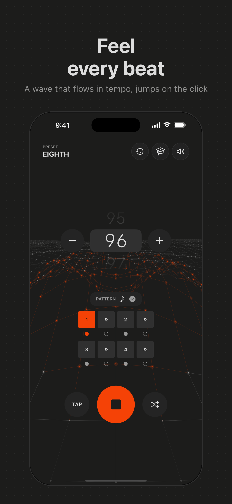
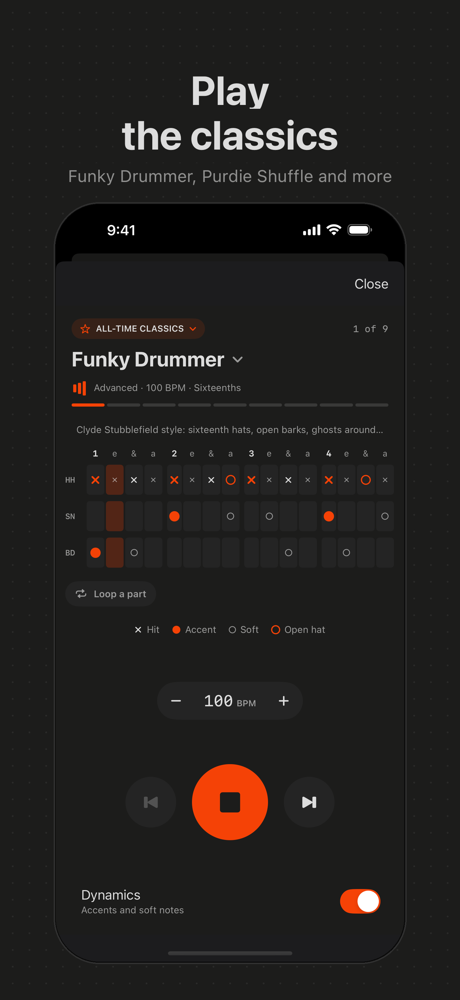
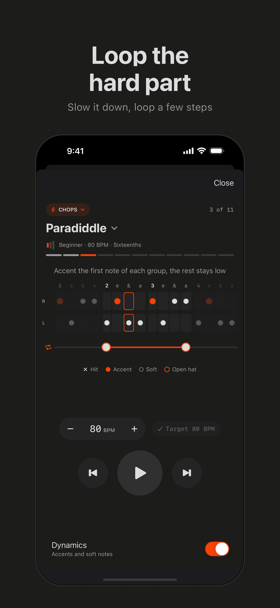
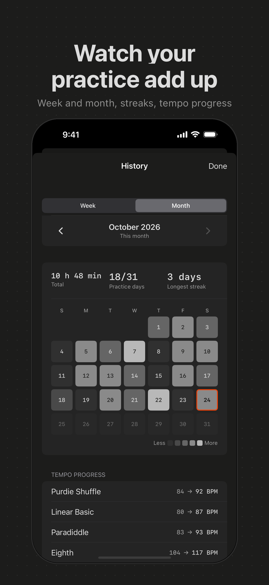
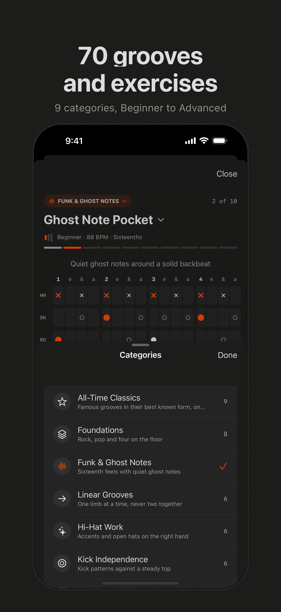

<div align="center">


# Metro Mate

**A metronome for drummers that doesn't sell you anything.**

No ads. No subscription. No account. No tracking.
Free forever, and you can read every line of code that makes it tick.

[**Download free on the App Store**](https://apps.apple.com/app/id6747667519)






</div>

---

## Why another metronome?

Open the App Store and search for "metronome". You'll find a wall of free apps
that show you a video ad between practice sessions, or ask €6.99 a year for a
click track, technology that was invented in 1815.

Metro Mate is the metronome I wanted for my own practice: it starts instantly,
it keeps perfect time, it helps me learn grooves, and it gets out of the way.
It is open source, which means the "no tracking" promise above isn't something
you have to take on faith. You can check.

## The click

**A click you can see.** Behind the controls a field of connected dots flows
toward you in tempo and jumps on every beat. Accents hit harder, the space
between the beats stays calm. It is synced to what you actually hear, including
Bluetooth latency, and it stops drawing when nothing plays, so your phone stays
cool.

**Time you can trust.** Every click is scheduled sample-accurately on the audio
timeline, never on the main thread, so it does not drift when your phone gets
busy. Tempo changes land on the next beat without breaking the groove. The
screen stays on while you play and the click keeps going in the background and
with the ringer on silent.

**A tempo wheel made for fingers.** Drag the number like a detented dial from
1 to 300 BPM, with a haptic tick per BPM, a firmer one every 10 and a hard stop
at the ends. Tap or hold the big plus and minus keys, or tap along with a track.

**Accents and subdivisions.** Quarters, eighths, sixteenths and triplets of
each, counted as `1 & 2 &` or `1 e & a`. Tap a beat to mute it, accent the ones
you want, shuffle a random pattern (with undo) and save your own presets.

**Seven click sounds.** Cowbell, Classic woodblock, Clean, Claves, Pocket,
Punch and Deep. Recorded instruments, not cheap beeps.

## Learn



**70 grooves and exercises** in nine categories from beginner to advanced:
All-Time Classics in the style of Funky Drummer, Purdie Shuffle, Amen Break and
more, funk and ghost notes, linear grooves, hi-hat work, kick independence,
shuffles and triplets, accent studies and chops with R/L sticking.

**Hear every groove on a real kit.** Each one is a drum grid you can play,
with a running playhead. Dynamics on gives you accented hats on the beat, soft
notes in between and ghost notes on the snare; dynamics off plays every hit at
one level.

**Practise the hard part.** Touch and drag across the grid to freeze the groove
and hear one column at a time; let go and it plays on from there. Loop any
part of the bar, and hear the new loop the moment you drag a handle.

**Your kit, your sound.** Pick your snare, kick, hi-hats and practice pad in
settings, with a single-hit preview and a groove example for each. Metro Mate
remembers your tempo for every groove and where you left off.

<br clear="right">

## History

Every session longer than 30 seconds is saved, short pauses stay in the same
session. The week view shows practice time per day and how you compare to last
week. The month view is a calendar with your streak and your tempo progress per
groove, for example "Ghost Note Pocket 84 to 96 BPM". All of it stays on your
device.

## Hands-free with Siri

"Start Metro Mate at 90 BPM" works from across the room, useful when your hands
are already on the instrument. Works in English and German.

## Get it

[**Metro Mate on the App Store**](https://apps.apple.com/app/id6747667519):
free, no in-app purchases, no ads. Requires an iPhone with **iOS 16 or later**.

If Metro Mate is useful to you, **please leave a rating**. It's a free app with
no marketing budget, and App Store ratings are essentially the only way other
musicians will ever find it.

## For teachers

- The **counting display** matches how you say it out loud, so students connect
  the sound to the syllables.
- **Learn** gives students grooves to work on between lessons, with loops for
  the bar that trips them up and a history that shows the practice.
- **Presets** mean you can set up "student's tempo this week" once and recall it
  next lesson.
- No ads means nothing inappropriate appears mid-lesson, and no login means
  students under 13 can use it without a parent setting up an account.

If it's missing something you need for teaching,
[tell me](https://github.com/alexfriedl/metro-mate-ios/issues/new/choose).

## Feedback and bugs

Found something broken, or missing a feature you rely on?
**[Open an issue](https://github.com/alexfriedl/metro-mate-ios/issues/new/choose)**.
You don't need to be a programmer. "The click drifts when I switch apps" is a
perfect bug report. An App Store review works too, I read all of them.

## Privacy

Metro Mate collects nothing. No analytics, no crash reporting, no advertising
identifiers, no network requests at all. Presets, settings and your practice
history live on your device and nowhere else. See [PRIVACY.md](PRIVACY.md).

## Sounds

All drum and click samples are recorded instruments released under CC0
(public domain): Frankensnare and Virtuosity Drums by Karoryfer Samples and
Versilian Studios, the Versilian Community Sample Library, and a practice pad
from Freesound. The Clean tone is generated in the app. Details in
[Metronome/Sounds/SOURCES.md](Metronome/Sounds/SOURCES.md).

## Contributing

Contributions are welcome, and **not just code**. Bug reports, feature ideas
from real practice rooms, new grooves, translations and better sounds (CC0 or
your own recordings) are all genuinely useful. See
[CONTRIBUTING.md](CONTRIBUTING.md).

## Building from source

<details>
<summary>Developer instructions</summary>

**Requirements:** Xcode 16+, iOS 16.0+ deployment target, Swift 5.9+

```bash
git clone https://github.com/alexfriedl/metro-mate-ios.git
cd metro-mate-ios
open Metronome.xcodeproj
```

**Project structure**

| File | Purpose |
| --- | --- |
| `MetronomeApp.swift` | App entry point |
| `ContentView.swift` | Main screen, sound settings, presets |
| `MetronomeManager.swift` | Metronome state, presets, saved settings |
| `ClickEngine.swift` | Sample-accurate click scheduling on `AVAudioEngine` |
| `ClickSound.swift` | Click voices and sample loading |
| `PulseFieldView.swift` | Wave field background, driven by the audio clock |
| `BPMControl.swift` | Tempo wheel with haptics |
| `Groove.swift`, `GrooveLibrary.swift` | Groove model, groove player, the 70 grooves |
| `LearnView.swift` | Learn player, grid, loops, pickers |
| `DrumKit.swift` | Choosable kit sounds for Learn |
| `PracticeLog.swift`, `HistoryView.swift` | Practice history |
| `AppIntents.swift` | Siri Shortcuts |
| `Sounds/` | CC0 samples and their sources |

Brand and store material lives in [docs/](docs/).

</details>

## License

[MIT](LICENSE). Use it, fork it, ship it, teach with it.

---

<div align="center">
Built by <a href="https://github.com/alexfriedl">Alexander Friedl</a>.
If Metro Mate is useful to you, a star helps other musicians find it.
</div>
